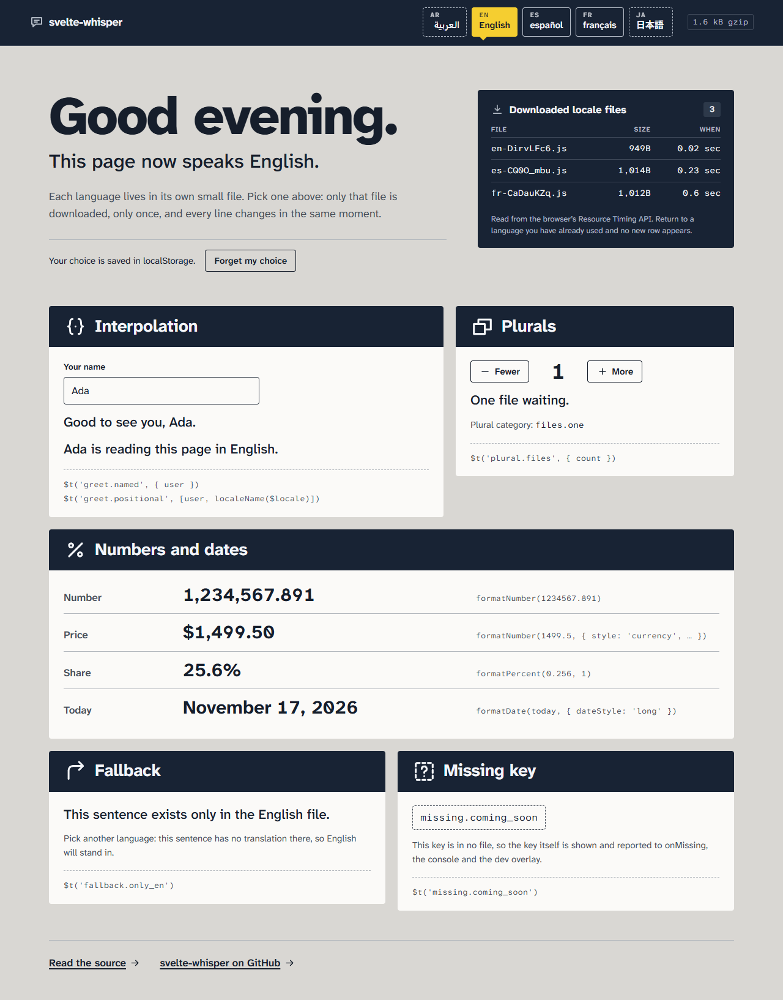
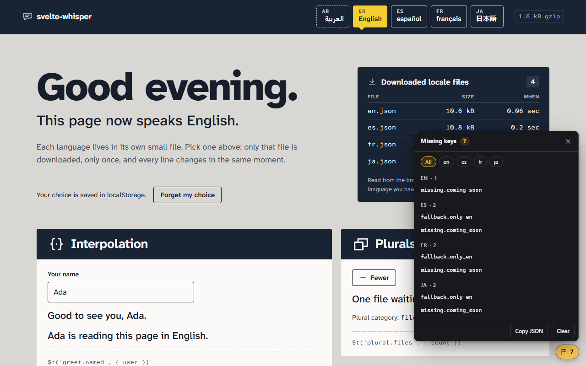

# Svelte Whisper 🤫

Tiny runtime i18n for Svelte 5 single-page apps, built on runes. Locales load on demand, the API is a handful of functions, and the whole thing adds about **1.6 kB** to your bundle.

```svelte
<script>
    import { t, setLocale } from 'svelte-whisper';
</script>

<h1>{t('greeting', { name: 'Ada' })}</h1>
<p>{t('cart.items', { count: 3 })}</p>

<button onclick={() => setLocale('fr')}>Français</button>
```

- **Small.** 1.6 kB gzipped for a typical app, 1.8 kB with every export. No dependencies beyond Svelte. No extra build plugin, no code generation.
- **Lazy.** Each language is its own chunk, downloaded when it is first needed. Users never pay for a language they do not read.
- **Runes.** `t()` is one plain function. Call it in markup, in `$derived`, in `$effect` or in a `.js` module, and whatever called it updates when the language changes. There are no stores.
- **Complete enough.** Interpolation, plurals, number, date and percent formatting, browser language detection, persistence, fallbacks, typed keys, and tooling for missing translations.
- **Fast.** A lookup is one signal read and one property read, about 10 ns. See [Size and speed](#size-and-speed).

[](https://shilo.github.io/svelte-whisper/demo/)

**[Try the live demo](https://shilo.github.io/svelte-whisper/demo/)**, or read its source in [`example/`](example): it is the recommended setup in about a hundred lines.

It is built for client-side apps: a Vite single-page app or a PWA. See [How it compares](#how-it-compares) for when another library fits better.

## Contents

- [Install](#install)
- [Quick start](#quick-start)
- [Translating](#translating)
- [Formatting](#formatting)
- [Locales](#locales)
- [Missing keys](#missing-keys)
- [Typed keys](#typed-keys)
- [API](#api)
- [Recipes](#recipes)
- [Locale tools and agent skills](#locale-tools-and-agent-skills)
- [Editor](#editor)
- [Size and speed](#size-and-speed)
- [How it compares](#how-it-compares)
- [Changes from 1.x](#changes-from-1x)

## Install

```bash
npm install github:Shilo/svelte-whisper
```

Pin a release by adding its tag: `github:Shilo/svelte-whisper#v2.0.0`. Requires `svelte@^5.9.0`.

The library is one runes module, `index.svelte.js`, which your app's Svelte plugin compiles like any other. There is nothing else to configure. Because it is compiled with your app, it cannot be imported from plain Node without Svelte.

## Quick start

Put one JSON file per language in `src/locales/`. The file name is the locale id.

```json
{
    "greeting": "Hello {name}!",
    "nav": { "home": "Home", "settings": "Settings" },
    "cart": {
        "items": { "0": "Your cart is empty", "one": "{count} item", "other": "{count} items" }
    }
}
```

Register the files and initialise before mounting the app:

```js
// src/main.js
import { mount } from 'svelte';
import { init, registerLoader } from 'svelte-whisper';
import App from './App.svelte';

registerLoader(import.meta.glob('./locales/*.json'));
await init({ fallback: 'en', persistKey: 'my-app-locale' });

mount(App, { target: document.getElementById('app') });
```

`import.meta.glob` makes every locale a separate chunk. `init` picks the starting locale and downloads only that one, so the first paint is already translated.

### Without any setup

If you register nothing, locales are fetched from `locales/{locale}.json` in your public folder:

```svelte
<script>
    import { t, setLocale } from 'svelte-whisper';
    setLocale('en'); // fetches /locales/en.json
</script>

<h1>{t('greeting', { name: 'Ada' })}</h1>
```

This is handy for prototypes. The fetched files are not hashed or bundled, so prefer loaders for production.

## Translating

`t(key, vars?)` is the whole translation API, and it works the same everywhere:

```svelte
<script>
    import { t } from 'svelte-whisper';

    const title = $derived(t('nav.settings').toUpperCase());
</script>

<h1>{t('nav.home')}</h1>
<h2>{title}</h2>
<button onclick={() => alert(t('greeting', { name: 'Ada' }))}>…</button>
```

It is reactive in the Svelte sense: markup, `$derived` and `$effect` that call it run again when the locale or a dictionary changes. The same holds when the call is inside a helper in a plain `.js` or `.ts` module, such as a toast or a formatter of your own.

**Keys** are dotted paths into your JSON: `nav.home`. A key that is missing from the active locale is looked up in the fallback locale, and if it is missing there too, the key itself is returned.

**Interpolation** replaces placeholders with values:

| Dictionary | Call | Result |
|---|---|---|
| `"Hello {name}!"` | `t('greeting', { name: 'Ada' })` | Hello Ada! |
| `"{0} of {1}"` | `t('progress', [3, 10])` | 3 of 10 |

A placeholder with no matching value is left as written, so mistakes are visible. Indexed placeholders can appear in any order, which lets a translation reorder them.

**Plurals** are objects keyed by plural category, chosen by a numeric `count`:

```json
{ "items": { "0": "Your cart is empty", "one": "{count} item", "other": "{count} items" } }
```

```svelte
{t('items', { count })}
```

An exact number (`"0"`) wins, then the category the browser's `Intl.PluralRules` gives for the active locale, then `other`. Each language uses the categories it needs: Japanese needs only `other`, Russian needs `one`, `few`, `many` and `other`. Every plural group must have an `other` form, which is also what `t('items')` returns when no count is given.

**Always a string.** `t()` returns text and nothing else. A number or boolean in the JSON comes back as text, and items of a list are addressed by index: `t('rules.0')`. A key that points at a group or a list is not a message, so it comes back as the key, like any other missing key.

## Formatting

Thin wrappers over `Intl`, bound to the active locale. Formatter objects are cached, and calls update when the locale changes, exactly like `t()`.

```svelte
<script>
    import { formatNumber, formatDate } from 'svelte-whisper';
</script>

{formatNumber(1234567.5)}                                        <!-- 1,234,567.5 · 1.234.567,5 -->
{formatNumber(42, { style: 'currency', currency: 'EUR' })}       <!-- €42.00 · 42,00 € -->
{formatNumber(1500000, { notation: 'compact' })}                 <!-- 1.5M · 150万 -->
{formatNumber(0.256, { style: 'percent' })}                      <!-- 26% · 26 % -->
{formatDate(Date.now(), { dateStyle: 'long' })}                  <!-- March 5, 2026 · 5 mars 2026 -->
```

`formatNumber` and `formatDate` take any [`Intl.NumberFormat`](https://developer.mozilla.org/docs/Web/JavaScript/Reference/Global_Objects/Intl/NumberFormat/NumberFormat#options) or [`Intl.DateTimeFormat`](https://developer.mozilla.org/docs/Web/JavaScript/Reference/Global_Objects/Intl/DateTimeFormat/DateTimeFormat#options) option, and an optional third argument to format in a specific locale. For anything else `Intl` offers, pass `getLocale()` to it yourself.

## Locales

```svelte
<script>
    import { getLocale, setLocale, getLocales, localeName, resetLocale } from 'svelte-whisper';
</script>

<select bind:value={getLocale, setLocale}>
    {#each getLocales() as id}
        <option value={id}>{localeName(id)}</option>
    {/each}
</select>

<button onclick={resetLocale}>Use my browser's language</button>
```

- `getLocale()` is the active locale, and is reactive. `setLocale(id)` switches.
- Switching downloads the dictionary if needed and only then changes the text, so users never see a flash of raw keys. The promise resolves `true` once active, or `false` if the download failed, in which case the locale stays as it was and a bound `<select>` returns to it.
- `localeName('ja')` returns `日本語`: every language is listed under its own name, with no translation keys to maintain. `localeName('ja', 'en')` returns `Japanese`.
- `loadLocale(id)` downloads a locale without switching, for example on hover.
- `<html lang>` and `dir` are kept in step. Direction comes from the script the browser associates with the locale, so Arabic, Hebrew, Persian, Urdu and the rest are `rtl` with no list to maintain.

### How the starting locale is chosen

`init()` tries these in order and uses the first that loads:

1. The choice stored under `persistKey`.
2. The browser's languages (`navigator.languages`), matched against your locales by language and script: an exact id first (`pt-BR`), then the same region, then any region (`en-GB` → `en-US`). The browser fills in what a tag implies, so `zh-TW` finds `zh-Hant` and never `zh-Hans`, with nothing to configure.
3. `initial`.
4. `fallback`.

Only an explicit `setLocale()` is stored. A detected locale is not, so a user who changes their browser language gets the new one. `resetLocale()` forgets the stored choice and chooses again.

## Missing keys

A key that is missing from the active locale is reported once per locale, even when the fallback provides text for it.

```js
await init({
    fallback: 'en',
    onMissing: ({ locale, key }) => report(`Missing ${key} in ${locale}`),
});
```

Without `onMissing`, each one is logged with `console.warn`. Pass `warn: false` for silence, or `warn: true` to keep the warnings alongside your handler.

### Dev overlay

In Vite's dev server a small badge appears when keys are missing. Open it to see them grouped by locale as you move through the app. Click a key to copy it, or use **Copy JSON** to get a skeleton of every missing key, ready to paste into a locale file.



The overlay is a separate chunk that is requested only in dev mode. It is removed from production builds, and it stays out of the way of browser automation. Turn it off with `devOverlay: false`.

To check every key without clicking through the app, use [`svelte-whisper check`](#locale-tools-and-agent-skills).

## Typed keys

Tell the library about your source dictionary once, and keys autocomplete and are type-checked. There is no generated code and no runtime cost.

```ts
// src/whisper.d.ts
import type en from './locales/en.json';

declare module 'svelte-whisper' {
    interface Register {
        dictionary: typeof en;
    }
}
```

```ts
t('nav.home');   // ok
t('nav.hmoe');   // type error
```

This needs `"resolveJsonModule": true`. Valid keys are the paths that hold a message: strings, plural groups, arrays and their items. For a key built at runtime, cast it: `` t(`skills.${id}` as WhisperKey) ``.

## API

Thirteen functions, all named exports of `svelte-whisper`:

```js
// Setup, once, before mounting
registerLoader(import.meta.glob('./locales/*.json'));   // lazy: one chunk per file
registerLoader('fr', () => import('./fr.json'));        // or one locale at a time
addDictionary('en', en);                                // or already in memory (then 'en' needs no loader)
await init({ fallback: 'en', persistKey: 'locale' });

// Translate and format: reactive wherever they are called
t('greeting', { name: 'Ada' });                         // 'Hello Ada!'
t('cart.items', { count: 3 });                          // '3 items'
formatNumber(1234.5);                                   // '1,234.5'
formatNumber(0.256, { style: 'percent' });              // '26%'
formatDate(Date.now(), { dateStyle: 'long' });          // 'March 5, 2026'

// Locale
getLocale();                                            // 'en'
await setLocale('fr');                                  // true once active
await loadLocale('ja');                                 // preload without switching
await resetLocale();                                    // forget the stored choice
getLocales();                                           // ['en', 'fr', 'ja']
detectLocale();                                         // best match for the browser, or ''
localeName('ja');                                       // '日本語'
```

### Setup

| | |
|---|---|
| `init(options?)` | Choose the starting locale and load it. Returns a promise. |
| `registerLoader(id, loader)` | Register a function that returns a dictionary, or a module whose default export is one. It runs once, on first use. |
| `registerLoader(globRecord)` | Register every entry of an `import.meta.glob` result. The file name is the locale id. |
| `addDictionary(id, dict)` | Add translations that are already in memory. Merges with what is there. A locale that has a dictionary counts as loaded, so its loader is not called. |

`init` options:

| Option | Default | |
|---|---|---|
| `fallback` | `'en'` | Locale used for keys missing from the active one. |
| `initial` | | Starting locale when nothing is stored or detected. |
| `persistKey` | | `localStorage` key for the user's explicit choice. |
| `detect` | `true` | Start in the browser's language when you have it. `false` turns it off. |
| `onMissing` | | `({ locale, key }) => void`, once per missing key and locale. |
| `warn` | `true` | `console.warn` on missing keys. Defaults to `false` when `onMissing` is set. |
| `devOverlay` | `true` | The missing-key overlay in Vite dev mode. |

### Locale

| | |
|---|---|
| `getLocale()` | The active locale id. Reactive. |
| `setLocale(id)` | Switch, loading first if needed. Resolves `true`, or `false` if the load failed or a newer call replaced this one. |
| `loadLocale(id)` | Load without switching. Resolves `true` or `false`. |
| `resetLocale()` | Forget the stored choice and choose again. |
| `getLocales()` | Every id that has a loader or a dictionary. |
| `detectLocale()` | The locale that best matches the browser's languages, or `''`. |
| `localeName(id, displayLocale?)` | A language's name, in its own language by default. |

### Translation and formatting

| | |
|---|---|
| `t(key, vars?)` | Translate. Reactive. |
| `formatNumber(value, options?, locale?)` | `Intl.NumberFormat`. Reactive unless `locale` is given. |
| `formatDate(value, options?, locale?)` | `Intl.DateTimeFormat`. Takes a `Date` or a timestamp. Reactive unless `locale` is given. |

"Reactive" means that markup, `$derived` and `$effect` calling the function run again after a locale or dictionary change.

## Recipes

### Bundle the main language

With every language lazy, the app waits for one small extra request before it renders. To avoid it, put your main language in the bundle and keep the others lazy:

```js
import en from './locales/en.json';

addDictionary('en', en);
registerLoader(import.meta.glob(['./locales/*.json', '!./locales/en.json']));
await init({ fallback: 'en' });
```

The trade is download size: every user now receives the main language, including those who read another one.

### Rich text

Dictionaries are part of your code, so it is safe to keep markup in them and render it with `{@html}`:

```json
{ "terms": "I accept the <a href=\"/terms\">terms</a>." }
```

```svelte
<p>{@html t('terms')}</p>
```

Escape any user-supplied value before interpolating it into such a string.

### Whole sentences only

Do not assemble a sentence from translated pieces. `t('your') + ' ' + t('cart')` cannot be translated correctly, because word order, agreement and particles differ between languages. Give each sentence its own key and use placeholders for the parts that vary.

### Apps with a service worker

PWA plugins precache every build chunk by default, which downloads all your languages on install. Exclude the locale chunks from the precache and cache them on first use. The [`whisper-setup` skill](skills/whisper-setup/SKILL.md#7-apps-with-a-service-worker) has the configuration for `vite-plugin-pwa`.

### Tests

The library is a runes module, so test it the way you test your components: through your Svelte-aware test runner (Vitest with the Svelte plugin). Call `addDictionary` with a small dictionary and `await init({ detect: false, devOverlay: false })` in your test setup. `setLocale` is synchronous when the dictionary is already in memory.

## Locale tools and agent skills

A zero-dependency command line tool ships with the package. It never touches your bundle.

```bash
npx svelte-whisper check --usage src   # missing, extra, unused and undefined keys, placeholder mismatches
npx svelte-whisper diff --since v1.4.0 # source strings added or reworded since a commit
npx svelte-whisper apply fr new.json   # merge translations, drop stale keys, keep source order
npx svelte-whisper sync                # tidy every locale without translating
```

`check` exits with an error when a locale is out of step with the source, or when `--usage` finds code using a key that does not exist, so it works as a CI gate. It finds the locale folder itself, or reads it from `package.json`:

```json
{ "svelte-whisper": { "locales": "src/locales", "source": "en" } }
```

Fixed terms that must never be retranslated go in `glossary/<locale>.json` beside the locale files, in the same shape. `apply` and `sync` write them over anything else, and `check` fails if one is changed.

### Agent skills

The [`skills/`](skills) folder teaches coding agents (Claude Code, Codex, Cursor and others that read the Agent Skills format) to do the routine work with these tools:

| Skill | Use it to |
|---|---|
| [`whisper-setup`](skills/whisper-setup/SKILL.md) | Add svelte-whisper to an app, or move hard-coded text into locale files. |
| [`whisper-translate`](skills/whisper-translate/SKILL.md) | Translate new and changed strings, or add a language, without retranslating everything. |
| [`whisper-audit`](skills/whisper-audit/SKILL.md) | Find missing, unused and broken translations. |

Install them into a project with:

```bash
npx skills add Shilo/svelte-whisper
```

Project-specific guidance (tone, brand names, notes per language) belongs in a `TRANSLATING.md` file in your locale folder; the translate skill reads it.

## Editor

A companion editor lets translators work on the JSON files in a grid, in the browser, and send their changes as a pull request. It runs entirely client-side and talks to GitHub directly.

**[Open the editor](https://shilo.github.io/svelte-whisper/)** · [About and self-hosting](editor/README.md)

## Size and speed

Measured with `npm run size` (compiled as an app's Svelte plugin would, minified with esbuild, Svelte's own runtime not counted):

| Imports | Minified | Gzip | Brotli |
|---|---|---|---|
| Typical app: `init`, `t`, `getLocale`, `setLocale`, `registerLoader` | 3.2 kB | 1.6 kB | 1.5 kB |
| Every export | 3.6 kB | 1.8 kB | 1.6 kB |

The module has no dependencies: its only import is its own dev overlay, in dev mode. A size budget is enforced in CI.

Measured with `npm run bench` (Node 25, one core of a desktop CPU, a 600-message dictionary):

| Operation | Time |
|---|---|
| Key lookup | 10–16 ns |
| Missing key | 27 ns |
| Interpolation, two placeholders | 150 ns |
| Plural | 390 ns |
| `formatNumber` | 370 ns |

Dictionaries are flattened once when they are added, which is why nesting depth does not matter.

## How it compares

Svelte Whisper is deliberately small: a runtime library with no compiler, no message-format parser and no server integration. That is the right trade for a client-side app, and the wrong one for some others.

| | Approach | Library size, gzip | Build step |
|---|---|---|---|
| **svelte-whisper 2.0** | Runtime on runes, lazy JSON per locale | 1.6 kB | None |
| [typesafe-i18n](https://github.com/codingcommons/typesafe-i18n) 5.27 | Generated typed functions plus a small runtime | 1.3 kB plus generated code | Generator |
| [svelte-i18n](https://github.com/kaisermann/svelte-i18n) 4.0 | Runtime with ICU MessageFormat | 14.6 kB | None |
| [i18next](https://www.i18next.com) 27.1 | Runtime with plugins | 15.5 kB before plugins | None |
| [sveltekit-i18n](https://github.com/sveltekit-i18n/lib) 3.4 | Runtime, route-aware loading | 15.6 kB | None |
| [Paraglide JS](https://inlang.com/m/gerre34r/library-inlang-paraglideJs) 3.2 | Compiler that emits message functions | Depends on the messages you use | Compiler |

Sizes of the other libraries are Bundlephobia's figures for the versions shown, read in November 2026. They measure each package's main entry only, so treat them as an order of magnitude.

Choose something else when you need:

- **Server-side rendering or localised routes.** Svelte Whisper keeps one locale for the whole page in module state. Paraglide and sveltekit-i18n are built for per-request locales.
- **ICU MessageFormat**, with `select`, gender, ordinals or nested plurals inside one message. svelte-i18n and i18next support it. Svelte Whisper has plural objects and placeholders, nothing more.
- **One translation setup shared across frameworks.** i18next has adapters for most of them.
- **Messages checked and tree-shaken at build time.** Paraglide compiles each message into a function, so unused ones disappear from the bundle.

## Changes from 1.x

Version 2 is a rewrite on runes with a smaller API, and it does not keep compatibility with 1.x. The [changelog](CHANGELOG.md) lists what was replaced and by what.

## License

[MIT](LICENSE)
