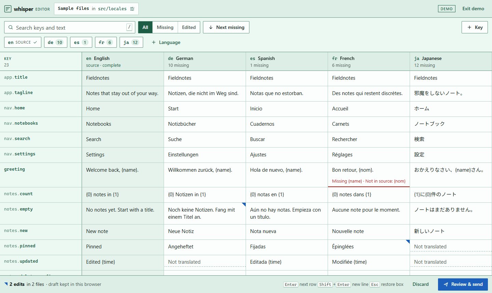

# svelte-whisper editor

A small, browser-only editor for the locale files of apps that use [svelte-whisper](../README.md). Open a repository, fill in what is missing, and send the result back as a pull request or a commit. There is no server and no database: the page talks to the GitHub API directly from your browser.

**Live:** https://shilo.github.io/svelte-whisper/ · **Try it without signing in:** https://shilo.github.io/svelte-whisper/?demo

<picture>
  <source media="(prefers-color-scheme: dark)" srcset="docs/screenshot-dark.png">
  
</picture>

## What it does

- Reads the locale files in a folder (default `src/locales`), one file per language. Only files named like a language tag count (`en.json`, `pt-BR.json`, `zh-Hant.json`), the same rule as the `svelte-whisper` command line tool, so `tsconfig.json` or `notes.json` in the same folder are ignored.
- Shows one row per key and one column per language. Nested objects appear as dotted keys, the same way svelte-whisper resolves them.
- Marks untranslated boxes (a missing key, or a `null` value, which svelte-whisper also reads as "not translated yet"), counts what is missing per language, and filters to **Missing** or **Edited** keys. **Next missing** (<kbd>Alt</kbd>+<kbd>N</kbd>) jumps to the next gap.
- Warns when a translation drops or invents a placeholder that the source language uses: named `{name}` or indexed `{0}`. Empty braces `{}` are plain text, as in svelte-whisper.
- Understands plural groups: sibling keys ending in `one`, `few`, `many`, `other` and so on, or an exact number such as `0`. Only `other` is required in each language; the other categories are marked optional, because languages use different sets.
- Adds, renames and deletes keys, and adds languages. Values that are not strings (numbers, arrays) are shown read-only and cannot be renamed or deleted here.
- Shows every change, file by file, before anything is sent. Each change can be undone there, and each file can be downloaded as JSON.
- Sends a **pull request** (default) or, for people with write access, a **commit** to the branch. Contributors without write access get a fork automatically, and the pull request goes to the original repository.
- Writes files back in their own format. Kept: indentation, line endings, a byte order mark, the final newline (or its absence), nested or flat dotted keys, and key order. New keys go where the source language has them. A file you did not edit is not sent at all. Normalised, because the file is rewritten with `JSON.stringify`: escapes (`\/` becomes `/`, `\u00e9` becomes `é`), numbers (`1.0` becomes `1`), a minified file is indented with tabs, and numeric keys such as a plural `"0"` move to the top of their object (a JavaScript object rule). Usually the diff is just the changed lines; check the review if a file uses any of these.
- Clearing a box removes the key from that file, so svelte-whisper falls back to the fallback language.
- Keeps unsent edits as a draft in your browser (per repository, branch and folder) and warns before you close a tab with unsent edits.
- Refuses to overwrite a file that changed on the branch after you loaded it.

Keyboard: <kbd>/</kbd> search, <kbd>Enter</kbd> next row, <kbd>Shift</kbd>+<kbd>Enter</kbd> new line, <kbd>Esc</kbd> restore the box to what the file says.

## Using it

1. Open the editor and sign in with GitHub, or paste a personal access token.
2. Enter the repository (`owner/name` or a GitHub URL) and the locales folder. Leave the branch empty to use the repository's default branch; the branch in use is shown in the top bar.
3. Fill in the gaps, then choose **Review & send**.

### Share a link with translators

Pre-fill the repository and show only one language next to the source:

```
https://shilo.github.io/svelte-whisper/?repo=owner/name&path=src/locales&lang=fr
```

`branch` and `path` are optional: without them the link opens the repository's default branch and `src/locales`. Add `&branch=…` to point at another branch.

### Tokens

A [fine-grained token](https://github.com/settings/personal-access-tokens/new) is the least-privilege way in: limit it to the one repository, with **Contents** and **Pull requests** set to *Read and write*. It works for public and private repositories. Contributors to someone else's repository can use a token for their own account; the editor opens the pull request from their fork.

**Continue with GitHub** asks for the OAuth `repo` scope, which covers every public and private repository the account can reach: OAuth Apps cannot be limited to one repository. Use a fine-grained token if that is more access than you want to give.

If the editor says a repository was not found, check the owner/name and the branch, and that the signed-in account (or the token's repository list) can see that repository: GitHub answers "not found" for private repositories it will not show you.

**Where the token lives.** The token is kept in `sessionStorage` for the open tab only. It survives a reload, is forgotten when the tab closes, and is sent only to `api.github.com`. It is never written to `localStorage`. The page ships a Content-Security-Policy that allows scripts only from the editor itself and network requests only to GitHub (and the sign-in proxy, when configured). The honest trade-off: any script running in the page could read a token in `sessionStorage`, as with every browser-only GitHub client; the CSP, the absence of third-party scripts and fonts, and a short-lived or fine-grained token are what limit that risk. Sign out to clear it immediately.

## Sign in with GitHub (OAuth device flow)

Without configuration the editor offers token sign-in only. To enable **Continue with GitHub**, the deployment needs a GitHub OAuth App and a tiny CORS proxy, because GitHub's OAuth endpoints do not send CORS headers.

The editor uses the [device flow](https://docs.github.com/en/apps/oauth-apps/building-oauth-apps/authorizing-oauth-apps#device-flow): the user enters a short code on github.com, and the page polls for the token. No client secret is involved, so nothing secret is built into the page. The editor requests the `repo` scope, so people can open private repositories too; a fine-grained token remains the narrower alternative (see [Tokens](#tokens)).

### 1. Register an OAuth App

1. Go to [github.com/settings/developers](https://github.com/settings/developers) → **New OAuth App**.
2. Homepage URL: your Pages URL, for example `https://your-name.github.io/svelte-whisper/`. Authorization callback URL: the same URL (the device flow does not use it, but GitHub requires one).
3. Register, then on the app's page tick **Enable Device Flow** and copy the **Client ID**. Do not create a client secret.

### 2. Deploy the CORS proxy (Cloudflare Worker)

Create a Worker (dashboard: **Workers & Pages → Create → Hello World**, then **Edit code**), paste this, and deploy:

```js
// Forwards the two OAuth device-flow endpoints to github.com and adds CORS headers.
// It stores nothing and handles no secrets; requests carry only the public client ID.
const ALLOWED_PATHS = new Set(['/login/device/code', '/login/oauth/access_token']);
// The origins that host the editor: the deployed site, plus the local dev server (npm run dev)
// and the local preview of a build (npm run preview) if you use them.
const ALLOWED_ORIGINS = new Set(['https://your-name.github.io', 'http://localhost:5173', 'http://localhost:4173']);

export default {
  async fetch(req) {
    const origin = req.headers.get('Origin');
    const cors = {
      'Access-Control-Allow-Methods': 'POST, OPTIONS',
      'Access-Control-Allow-Headers': 'Content-Type, Accept',
      'Access-Control-Max-Age': '86400',
      Vary: 'Origin',
      // Echo the caller's origin only when it is on the list; browsers block the rest.
      ...(ALLOWED_ORIGINS.has(origin) ? { 'Access-Control-Allow-Origin': origin } : {}),
    };
    if (req.method === 'OPTIONS') return new Response(null, { status: 204, headers: cors });
    const { pathname } = new URL(req.url);
    if (req.method !== 'POST' || !ALLOWED_PATHS.has(pathname)) {
      return new Response('Not found', { status: 404, headers: cors });
    }
    const res = await fetch('https://github.com' + pathname, {
      method: 'POST',
      body: await req.text(),
      headers: { 'Content-Type': 'application/x-www-form-urlencoded', Accept: 'application/json' },
    });
    return new Response(await res.text(), {
      status: res.status,
      headers: { ...cors, 'Content-Type': 'application/json' },
    });
  },
};
```

Copy the Worker URL, for example `https://whisper-auth.your-account.workers.dev`. With [Wrangler](https://developers.cloudflare.com/workers/wrangler/) instead: `npm create cloudflare@latest whisper-auth`, replace `src/index.js` with the code above, then `npx wrangler deploy`.

### 3. Configure the build

Both variables are required for GitHub sign-in; if either is missing, only token sign-in is shown.

| Variable | Value |
| --- | --- |
| `VITE_GITHUB_CLIENT_ID` | The OAuth App's Client ID. Public by design. |
| `VITE_CORS_PROXY_URL` | The Worker URL. Its origin is also added to the page's CSP. |

Locally, put them in `editor/.env.local` (git-ignored). For GitHub Pages, add them under **Settings → Secrets and variables → Actions** as repository secrets with the same names; [`deploy-editor.yml`](../.github/workflows/deploy-editor.yml) passes them to the build.

## Development

Requires Node.js 22.12 or newer (CI and the Pages build use Node 24).

```bash
cd editor
npm install
npm run dev      # http://localhost:5173, demo at /?demo, 3000-key stress test at /?demo=large (dev server only)
npm run check    # svelte-check, fails on any error or warning
npm test         # data-layer tests: file round trips, drafts, placeholders, plurals
npm run build    # static site in editor/dist
```

The editor is a plain Vite single-page app: `index.html` loads `src/main.js`, which mounts `src/App.svelte`. There is no router; the screens are driven by state and query parameters (`?demo`, `?repo=…`), so the build is one `index.html` plus hashed assets, with no fallback page. The Content-Security-Policy is added to the built `index.html` as a `<meta>` tag by a small plugin in `vite.config.js`; the dev server runs without it, because hot reload needs inline styles and a websocket. The Pages workflow builds with `BASE_PATH=/<repository name>`; to preview that locally, run `BASE_PATH=/svelte-whisper npm run build && BASE_PATH=/svelte-whisper npm run preview` and open `http://localhost:4173/svelte-whisper/`.

Built with Svelte 5 and Vite 8, without SvelteKit. `svelte.config.js` turns on runes mode for every component, so legacy syntax (`export let`, `$:`, `on:` and so on) does not compile. There are no runtime dependencies, no CSS framework and no web fonts. About 32 KB of gzipped JavaScript and 4 KB of CSS load on first visit; the grid and dialogs (about 9 KB of JavaScript and 3 KB of CSS) load once a document is open, and the demo's sample files (1.5 KB) only for the demo.

### Layout

| Path | Purpose |
| --- | --- |
| `index.html`, `src/main.js` | Page shell and the entry that mounts the app |
| `src/App.svelte` | Screen flow: sign-in, connect, loading, editor; drafts and sending |
| `src/lib/doc.svelte.js` | The document model: values, edits, keys, languages, drafts |
| `src/lib/json.js` | Locale file parsing, format-preserving writes, placeholder checks |
| `src/lib/lang.js` | Which file names are locales, and language names from `Intl` |
| `src/lib/github.js` | GitHub REST calls: read files, commit, fork, pull request |
| `src/lib/auth.js`, `session.svelte.js` | Device flow, token sign-in, stored settings |
| `src/lib/components/` | `Grid`, `Toolbar`, `StatusBar`, `ReviewDialog`, `SignIn`, dialogs |
| `src/lib/demo.js` | Sample files for the demo, loaded on demand (`demo-large.js`: the dev-only stress test) |
| `test/` | `node --test` suites for `json.js` and `doc.svelte.js` (compiled on the fly with `svelte/compiler`) |

The visual system is documented in [`DESIGN.md`](../DESIGN.md).

Inspired by inlang's [Fink](https://fink.inlang.com/) editor.
