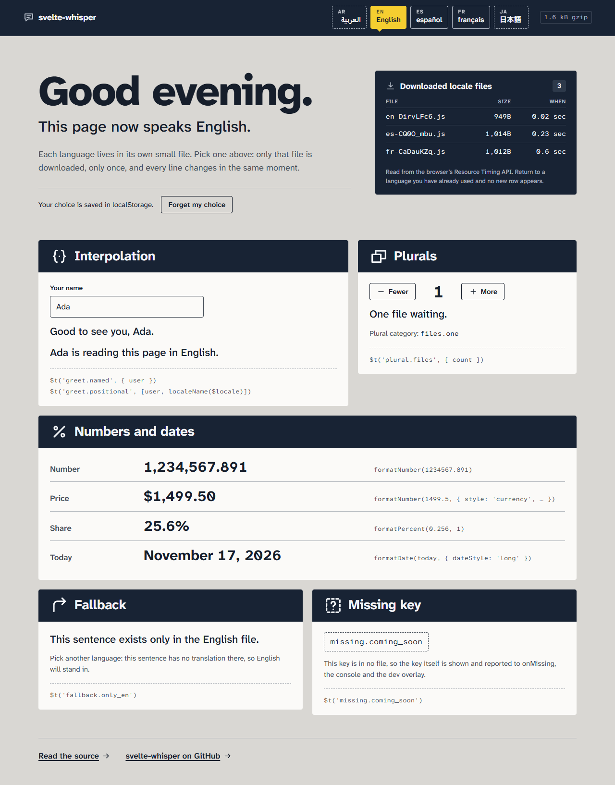

# svelte-whisper example

A single-page Svelte 5 + Vite app that shows what svelte-whisper does, and how little code it takes.
Read `src/` as documentation: it is the recommended setup, kept small on purpose.



## What it shows

- **Lazy loading you can watch.** Five locales (English, Spanish, French, Japanese, Arabic), one file each.
  The *Downloaded locale files* board lists every locale file the browser fetched, with its size
  and when it arrived, read from the Resource Timing API. Switch back to a language you already
  used and no new row appears.
- **Instant switching.** A language switcher built from `getLocales()` and `localeName()`.
  Text, numbers, dates, `<html lang>` and `dir` all change together. Arabic mirrors the layout.
- **Persistence.** `init()` is given a `persistKey`, so `setLocale()` remembers the choice and the next visit starts with it.
  *Forget my choice* calls `resetLocale()`, which drops it and picks again from the browser's languages.
  The app never touches the storage itself.
- **Interpolation.** Named (`{user}`) and indexed (`{0}`) placeholders, driven by a live input.
- **Plurals.** A counter that walks through each language's plural categories (Arabic has six).
- **Formatting.** `formatNumber` for numbers, currency and percentages, and `formatDate`, bound to the active locale.
- **Fallback and missing keys.** One sentence exists only in English and falls back everywhere
  else. One key exists nowhere, which makes the dev overlay appear in `npm run dev`.
- **A legacy component.** `src/lib/LegacyCount.svelte` switches runes off for itself and uses `export let`,
  `$t`, `$formatNumber` and `$locale`. It follows the same language switch and counter as the rest of the page.
- **`t()` outside components.** `src/greeting.js` translates from a plain module and stays reactive.
- **Typed keys.** `src/whisper.d.ts` registers `en.json`, so keys autocomplete and typos are
  underlined. The deliberately missing key is cast so the project type-checks cleanly.

## Run it

```sh
npm install
npm run dev       # http://localhost:5173, with the dev overlay
npm run build     # each locale becomes its own chunk in dist/assets/locales/
npm run preview
```

The example depends on the library in the parent folder (`"svelte-whisper": "file:.."`).
To deploy under a sub-path, set `BASE_PATH`: `BASE_PATH=/svelte-whisper/demo/ npm run build`. The Pages workflow does this and serves the demo at https://shilo.github.io/svelte-whisper/demo/.

## Source map

| File | What it does |
| --- | --- |
| `src/main.js` | The setup: `registerLoader(import.meta.glob(...))` and `init({ fallback, persistKey })`. |
| `src/locales/*.json` | One dictionary per locale; the file name is the locale id. |
| `src/App.svelte` | The page: every feature above, each next to the call that produces it. |
| `src/lib/LegacyCount.svelte` | A legacy component inside the runes app: the same calls with `$` in front. |
| `src/greeting.js` | `t()` in a plain JavaScript module. |
| `src/whisper.d.ts` | Typed keys through the `Register` interface. Types only. |
| `src/lib/LanguageGates.svelte` | The language switcher. |
| `src/lib/downloads.svelte.js` | Watches the network for locale files. Demo instrumentation, not needed in your app. |
| `src/lib/DownloadBoard.svelte`, `Sign.svelte`, `Pictogram.svelte` | Presentation. |
